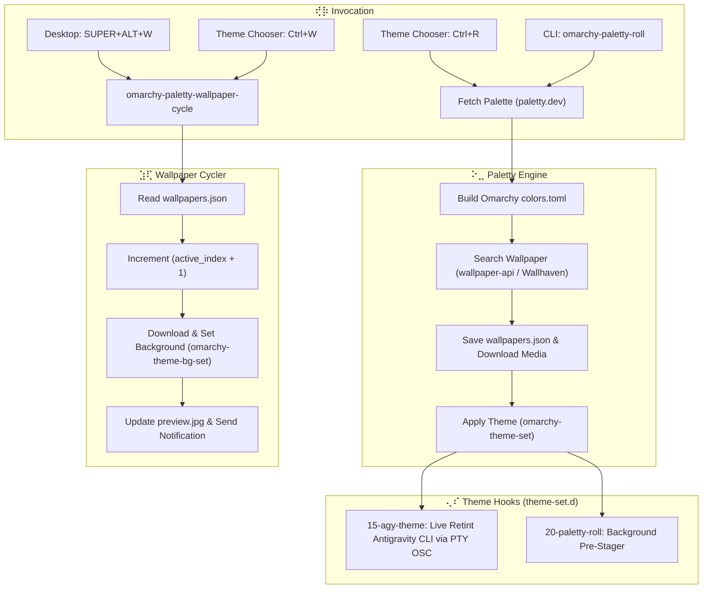

# ⢞⡷ Omarchy Paletty ⣱⢏

> Dynamic theme generation and perceptual wallpaper matching engine for Omarchy Linux, powered by **paletty.dev**, the self-hosted **wallpaper-api** (CIEDE2000 color space matching), and **Wallhaven.cc**.

---

## ⠕⣀ Overview

**omarchy-paletty** brings random, mathematically harmonious theming to Omarchy Linux desktop and the Antigravity CLI (`agy`). Just like the Android `omarchy-launcher`, it rolls a random palette from `paletty.dev`, matches high-resolution wallpapers using perceptual color space distances (CIEDE2000 in CIELAB), applies full system colors across Hyprland, Foot, Alacritty, Kitty, Ghostty, Neovim, and VS Code, and synchronizes the active `agy` AI interface live without restarting.

It also integrates seamlessly into the Omarchy Image Picker (`camkerr81.image-picker`), enabling users to roll themes on demand with `Ctrl+R` and cycle through matched wallpapers with `Ctrl+W`.

---

## ⢄⠎ Features

- **⠶ Random Paletty.dev Integration**: Fetches diverse color palettes with an offline fallback catalog.
- **⠶ Perceptual Wallpaper Matching**: Queries the self-hosted Docker `wallpaper-api` using CIEDE2000 $\Delta E$ in CIELAB color space, with automatic fallback to Wallhaven public search.
- **⠶ Live Antigravity CLI Retinting**: Custom theme hook dynamically discovers running `agy` processes via Linux `/proc/<pid>/fd` PTY enumeration and broadcasts OSC color escape sequences without restarting the process.
- **⠶ Wallpaper Cycler (`Ctrl+W`)**: Caches all candidate wallpapers in `wallpapers.json` and allows instant cycling with desktop notifications and resolution/$\Delta E$ readouts.
- **⠶ Zero-Latency Theme Switcher Integration**: Pre-stages the next theme in the background via `theme-set.d` hooks so rolls appear instantaneous.
- **⠶ Quickshell Modal Shortcuts**: Custom `camkerr81.image-picker` Quickshell plugin with tactile Braille iconography and direct keyboard shortcuts.

---

## ⢾⢷ Architecture



---

## ⠪⡕ Keybindings & Controls

| Context | Shortcut / Command | Action |
| :--- | :--- | :--- |
| **Theme Chooser** | `Ctrl + R` | Roll brand new random Paletty palette and wallpaper match |
| **Theme Chooser** | `Ctrl + W` | Cycle to next matched wallpaper in the current list |
| **Desktop / Hyprland** | `SUPER + ALT + W` | Cycle matched wallpaper globally |
| **Desktop / Hyprland** | `SUPER + CTRL + T` | Open Omarchy Theme Chooser |
| **Terminal / CLI** | `omarchy-paletty-roll` | Roll and apply a new theme immediately |
| **Terminal / CLI** | `omarchy-paletty-wallpaper-cycle` | Cycle to next matched wallpaper |
| **Terminal / CLI** | `omarchy-paletty-roll --prepare-next` | Pre-stage next theme without applying |
| **Omarchy Menu** | *Appearance → Roll Paletty Theme* | Roll new theme from launcher menu |
| **Omarchy Menu** | *Appearance → Cycle Matched Wallpaper* | Cycle wallpaper from launcher menu |

---

## ⢞⡷ Installation

Clone and run the idempotent installer:

```bash
git clone http://192.168.8.177:3000/camkerr81/omarchy-paletty.git
cd omarchy-paletty
./install.sh
```

The installer:
1. Installs `omarchy-paletty-roll` and convenience symlinks to `~/.local/bin/`.
2. Installs automation hooks to `~/.config/omarchy/hooks/theme-set.d/`.
3. Installs the `camkerr81.image-picker` Quickshell plugin to `~/.config/omarchy/plugins/`.
4. Appends `SUPER + ALT + W` keybinding to `~/.config/hypr/bindings.lua` and reloads Hyprland.
5. Pre-stages the initial theme candidate in the background.

---

## ⠶ CLI Reference

```bash
# Roll and apply a random theme immediately:
omarchy-paletty-roll

# Cycle to the next matched wallpaper for the active theme:
omarchy-paletty-wallpaper-cycle
# or:
omarchy-paletty-roll --cycle

# Filter wallpapers by category (general, anime, people):
omarchy-paletty-roll --category anime

# Save/archive rolled theme under a permanent unique name:
omarchy-paletty-roll --save

# Pre-stage next roll in background without immediately applying:
omarchy-paletty-roll --prepare-next
```

---

## ⣠⣇ Project Structure

```
omarchy-paletty/
├── bin/
│   ├── omarchy-paletty-roll              # Main Python engine & cycler
│   ├── omarchy-paletty-wallpaper-cycle   # Symlink to cycle mode
│   ├── omarchy-theme-roll                # Generic theme roll symlink
│   └── omarchy-theme-wallpaper-cycle     # Generic cycler symlink
├── hooks/
│   └── theme-set.d/
│       ├── 15-agy-theme                  # Live agy terminal PTY/OSC retinter
│       └── 20-paletty-roll               # Pre-stages next roll on theme activation
├── plugins/
│   └── camkerr81.image-picker/           # Quickshell overlay with Ctrl+R & Ctrl+W
├── config/
│   ├── hypr/
│   │   └── bindings.lua                  # Hyprland keybinding snippet
│   └── omarchy/
│       └── omarchy-menu.jsonc            # Omarchy menu extension snippet
├── install.sh                            # Automated installer
├── uninstall.sh                          # Clean removal script
├── LICENSE                               # MIT License
└── README.md
```

---

## ⢾⢷ License

MIT License (c) 2026 Cameron Kerr.
